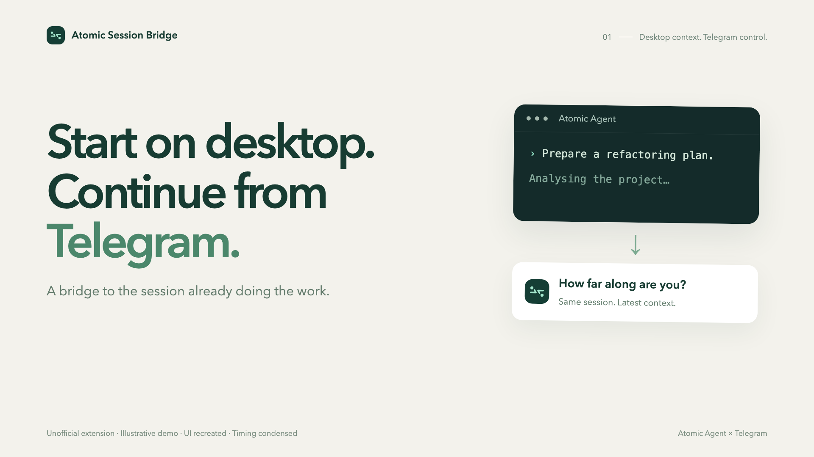

# Atomic Agent Telegram Session Bridge

Check progress, read an analysis, queue follow-up work, and stop a terminal
session from your phone through your own Telegram bot.

This is an unofficial extension for
[Atomic Agent](https://github.com/AtomicBot-ai/atomic-agent), distributed as a
reviewable patch against **v0.8.0**, commit
`6d1f14fcd4ae08e592a71fe52f0146c5aa7bab64`. It uses Atomic's existing session
store, per-session FIFO, Telegram pairing, approval controls, and outbound
message handling.

## Video demo

[](https://github.com/thiwi/atomic-agent-telegram-session-bridge/raw/refs/heads/main/docs/media/atomic-bridge-demo.mp4)

[Watch or download the MP4](docs/media/atomic-bridge-demo.mp4) · 1080p · English · Silent

Start on desktop, check progress in Telegram, review and approve a plan, then
inspect the result. This is an illustrative demo with recreated interfaces and
fictional content; it contains no personal chats, bot credentials or user data.
Timing is condensed.

## Example

Start a task in the patched Atomic terminal:

> Analyse this project's code and propose a refactoring plan. Reply in English.

In your private Telegram chat with your bot:

```text
/desktop
How far along are you?
Show me the result of your analysis
/queue Implement the plan
/queue Run the tests and review the changes
/status
```

Progress queries remain available while the desktop task or a queued request
runs. Follow-ups execute in the same session with its latest context. A queued
request's final answer is delivered in Telegram.

## Release status

This is an experimental extension for the pinned Atomic v0.8.0 revision,
distributed as a reviewed source patch rather than an official Atomic plugin.
It is suitable for a beta release; pending work is not restart-safe, and remote
control requires the terminal and Telegram adapter to share one process.

## Requirements and compatibility

- Node.js **25.7 or newer**, including npm. Node 26 is used in CI.
- Git on PATH.
- An Atomic model/provider configuration that works on your system.
- A Telegram bot and an account paired as its owner.
- The terminal process stays running and has network access to Telegram.

The extension uses portable Node/TypeScript APIs. Source modules, functions, and
new session markers use desktop-neutral names. Existing sessions with the legacy
`macTelegramBridge` marker remain readable. The connection command is `/desktop`.
It has no Homebrew, shell,
Keychain, MLX, absolute home directory, or Apple hardware dependency.
CI installs the pinned upstream source and runs the checks on macOS, Linux,
and Windows. Default macOS CI uses the explicit `macos-15-intel` pool because
GitHub's Apple Silicon pool has experienced runner allocation failures before
any test starts. For an additional Apple Silicon check, run the Test workflow
manually and select `macos-latest` in `macos_runner`. All platforms run the same
required checks; no failed tests are ignored. Atomic's own model, browser, and native package requirements also
apply. Choose a provider and model supported by your host.

## Install

Clone this repository and run these commands from its root:

```sh
node scripts/install.mjs
node scripts/verify.mjs
node scripts/run.mjs tui
```

The installer clones the pinned upstream tag into `runtime/`, verifies its exact
commit, checks and applies the patch, installs the upstream lockfile, then builds
Atomic. Its source checkout uses LF line endings on every platform so upstream
archive checksum validation also works on Windows. It creates an ignored `.runtime-path.json` only after a successful build.

To choose another **new** runtime directory:

```sh
node scripts/install.mjs --target "path with spaces/atomic-runtime"
```

If an install fails, choose a new directory for the retry. The installer leaves
its partial directory available for diagnosis. It preserves an existing target.

For a project's working directory, invoke the launcher using the path to this
repository:

```sh
node <bridge-repository>/scripts/run.mjs tui
```

The launcher preserves your current working directory. Its default state directory
is Atomic's usual one, so an existing configuration is reused. For a separate
installation, set `ATOMIC_AGENT_STATE_DIR` to a dedicated directory **before**
launching. Upstream's provider/model setup applies to that state directory.

The launcher also accepts Atomic CLI arguments, for example:

```sh
node scripts/run.mjs --help
node scripts/run.mjs --version
```

## Create and connect your Telegram bot

1. Open the official **@BotFather**, send `/newbot`, and follow its instructions.
   Use your own bot name and keep its token private.
2. Start the patched Atomic terminal. Enter `/telegram`, open the Telegram
   integration, and enter your bot token there. Enable the integration if needed.
   Atomic stores credentials in its local credential storage.
3. Enter `/telegram pair` in Atomic. In Telegram, open your bot and send
   `/start <PAIRING_CODE>` using the one-time code shown on your computer.
4. Start a task in the patched terminal, then send `/desktop` to the bot from
   your paired account. The terminal must have submitted a task using this build
   before the session is eligible.

Official references:

- [Telegram's bot setup tutorial and token instructions](https://core.telegram.org/bots/tutorial#obtain-your-bot-token)
- [Telegram Bot API reference](https://core.telegram.org/bots/api)
- [Telegram Bot FAQ](https://core.telegram.org/bots/faq)
- [Atomic Agent's upstream documentation](https://github.com/AtomicBot-ai/atomic-agent/tree/v0.8.0)

Tokens are entered locally. This repository contains no working token, bot
username, Telegram owner ID, session database, user configuration, or credentials.

## Commands

| Command or message | Behavior |
| --- | --- |
| `/desktop` | Connect to the only running eligible desktop session. If all are idle, select the most recently updated eligible session. |
| `/desktop <session-id>` | Connect to a specific session. When several are running, the bot lists IDs and project paths for selection. |
| `/status` or “How far along are you?” | Read status, completed steps, current plan step, last stored result, and outstanding remote request count. |
| `/result` or “Show me the result of your analysis” | Read the final answer to the latest request, or a current plan snapshot while work continues. |
| `/review` | Show the latest proposed plan, current Git change summary and recorded verification evidence, with approve/reject buttons. |
| `/review diff` | Include the tracked-file patch in a new review. |
| `/queue <request>` | Add a follow-up to the linked session's execution queue. Several requests execute in arrival order. |
| `/queue` | Show the number of outstanding Telegram requests and command usage. |
| `/cancel` | Cancel outstanding requests submitted through Telegram. |
| `/stop` | Request cancellation of the currently running linked desktop task and cancel its outstanding Telegram requests. |
| `/desktop off` | Disconnect when outstanding remote work has settled. The next normal message starts a separate Telegram conversation. |

After linking, ordinary messages such as “Implement the plan” also enqueue a
follow-up. Use `/queue` when you want the intent to be explicit.

Control messages are English. Follow-up prompts request English answers.
Existing answers and plan steps are returned verbatim, so their language follows
the original task. German progress/result input phrases remain accepted for
compatibility.

## Execution and cancellation

The bridge runs **inside the same Atomic process** as the terminal session.
Running a second `serve` process against the same state directory does not
connect to another process's in-memory turn queue.

Status is a read-only snapshot of the last saved work step. A long model response
or tool call can leave the snapshot unchanged until the next checkpoint.
Reading status or results does not ask the model to produce an estimate.

Up to 20 Telegram requests can be outstanding per chat, including attachments.
Additional requests are rejected explicitly. Each accepted request stays tied to
its original session, even after `/new` or `/switch`; use `/cancel` before changing
conversations if you want pending work discarded. Deleted or ineligible sessions
are checked again before execution and cannot be recreated by a queued request.

Pending follow-ups are kept in process memory. Closing Atomic or restarting its
Telegram channel cancels outstanding remote requests. Already completed turns
remain in Atomic's session store.

Cancellation is cooperative. A tool may take time to finish stopping.
Completed edits and external effects remain in place. Review the resulting
project state before requesting new work. If a session belongs to another
process or has an interrupted active turn, continue it in the current terminal
before sending another remote task.

## Review and approve a plan

Ask the desktop agent to prepare an implementation plan and wait for its final
answer. In the paired private chat, connect with `/desktop`, then send:

```text
/review
```

The bridge shows the latest final answer as the proposed plan, the repository's
current staged/unstaged change summary, untracked file names, and retained
verification commands/results from the latest request. It does not rerun tests
or treat a successful tool call as proof that tests passed. Missing or truncated
results are labelled explicitly. Changes include the entire repository and
are not attributed solely to the agent. `/review diff` includes the tracked-file
patch and replaces the previous review's buttons.

- **Approve plan** queues implementation of the exact reviewed plan in the same
  session. Existing tool permissions and approval requirements still apply.
- **Reject plan** dismisses that review. It runs no implementation and does not
  revert files that were already changed.

Only an idle linked session without outstanding Telegram work can be reviewed.
Buttons are restricted to the paired owner's private chat and original message,
work once, and expire in 30 minutes. New reviews, channel reconnects and shutdowns
invalidate old buttons. Session history and repository contents are checked again
on approval and at the runtime execution boundary. Changed or unavailable
snapshots require a new `/review`. Other commands such as `/queue` remain normal
explicit requests; this feature does not impose a global review policy.

Review reads Git without a shell, external diff drivers, text converters or
optional index writes. Reports mask recognized credentials and secrets known
from the environment. Review your own output before sharing sensitive projects;
masking cannot recognize every possible secret.

Review limits: 10,000 tracked/untracked files, 64 MiB of file content, 2 MiB per
Git command, 10 seconds per Git command, and 32,000 characters for the complete
report. Symlinks, submodules and incomplete/oversized snapshots are refused.
Ignored untracked files are excluded. Untracked file bytes contribute to the
freshness check but are not included in the displayed patch. External programs
can still edit files after the check; this is not a filesystem transaction.
Use a smaller worktree or inspect a large project locally if these limits apply.

## Access and privacy

Atomic's paired-owner check runs before the bridge handles a message. Desktop
access is restricted to that owner's private DM. Groups, other users, other
channel sessions, and incognito sessions cannot attach through this feature.

Linking or reading a session preserves its current approval route. A queued
Telegram turn binds its approval handler only after it acquires execution
ownership; it releases that handler at completion. Atomic's normal tool
permissions and approval policy still apply.

Status, project paths, results, and requested output are sent to the owner's
Telegram chat. Set up the bot and select the project with that destination in
mind. The extension adds no public server or webhook.

## Tests and development

```sh
npm test
node scripts/privacy.mjs
node scripts/verify.mjs
```

The repository tests cover portable installer helpers and privacy checks.
The patch includes focused tests for owner checks, private-chat restriction,
incognito exclusion, session selection, English command handling, stale results,
queue ordering, status queries during work, cancellation, approval ownership,
and reloading the latest context between desktop and Telegram turns.

`verify.mjs` runs the upstream production typecheck, import checks, documentation
checks, Telegram tests, runtime turn ownership tests, and test-typecheck baseline.
The full upstream test typecheck uses a 4 GiB Node heap by default; an explicit
`NODE_OPTIONS` heap setting takes precedence.

Edit the patch against the pinned source revision, rebuild and retest it, then
commit the updated patch. Review `git diff` and run the privacy scanner before
publishing. The scanner is a supplementary check; it does not replace reviewing
the exact release files.

## Updating and uninstalling

This extension supports the pinned Atomic revision. A different upstream version
needs a reviewed and tested patch. Use this repository's launcher to run the
patched build after an upstream binary update.

To return to your regular Atomic installation, exit the patched terminal and
launch your original Atomic executable. The standalone installer does not replace
that executable. Remove the bridge checkout and its selected runtime directory
when you no longer need them. Keep your Atomic state directory if you want to
retain conversations, pairing, and configuration.

## License and attribution

MIT. This repository includes a patch to Atomic Agent and retains the upstream
MIT notice in `LICENSE`. Atomic Agent and Telegram remain their respective
projects. This extension is independently maintained.
